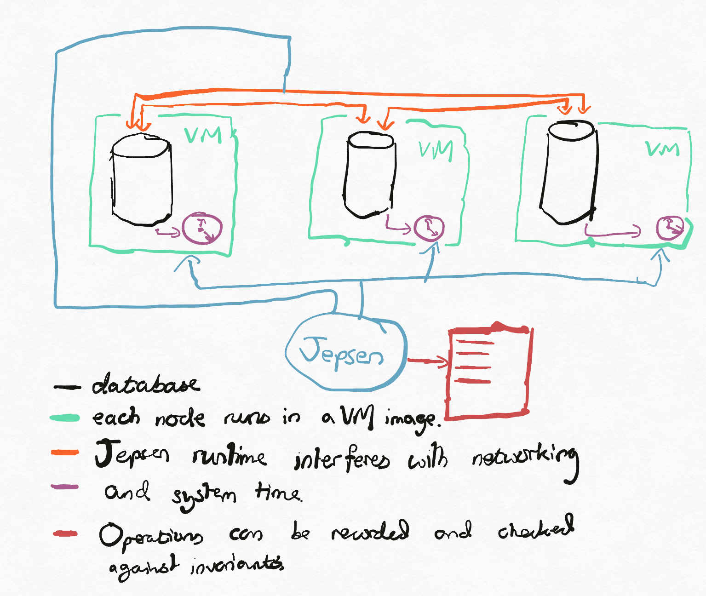
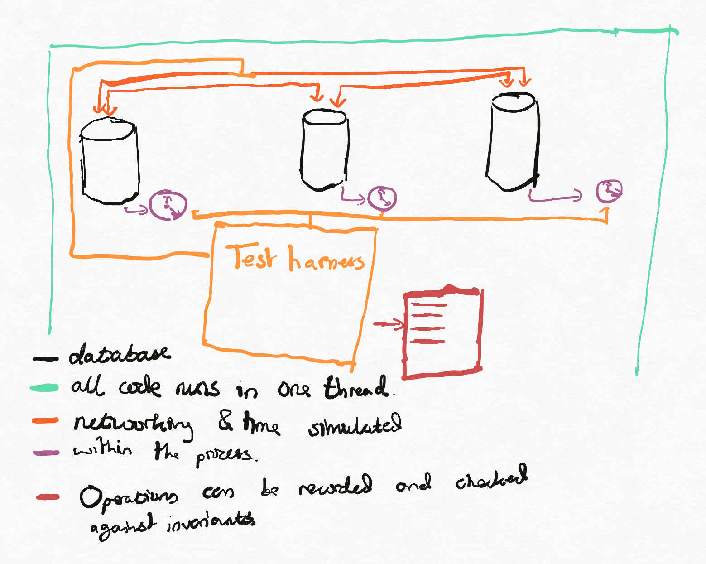
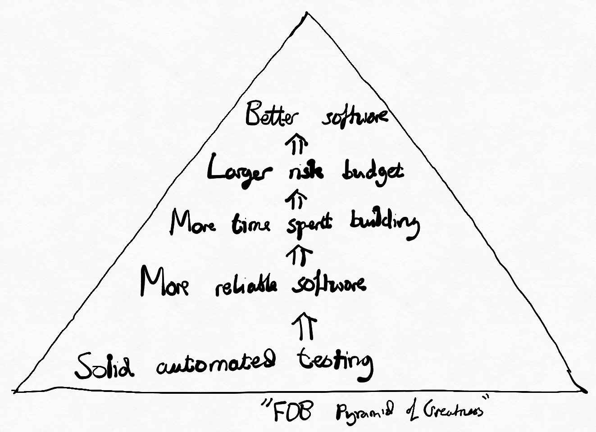
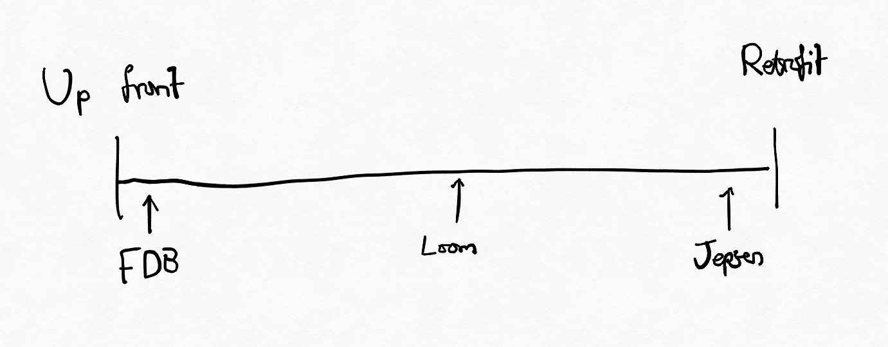
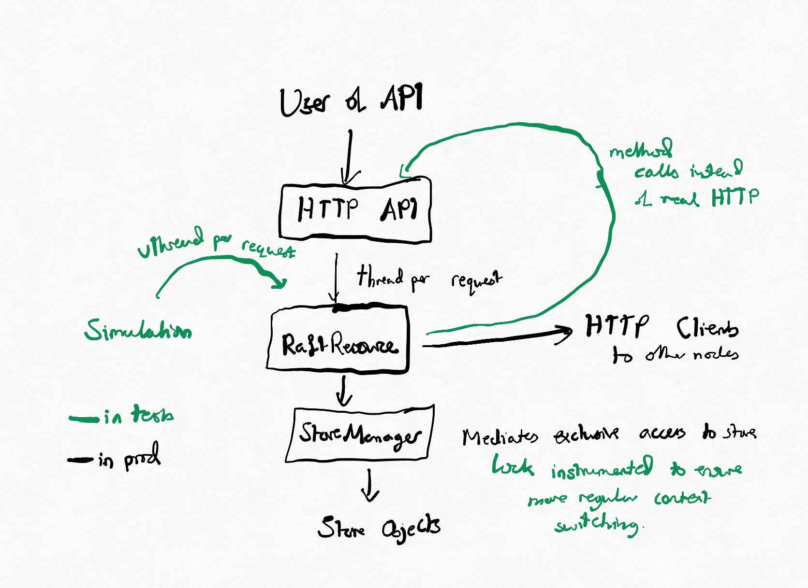

Building distributed databases is very difficult. There are lots of clever ideas you can put into a distributed database, but making the ideas work well together in a real system can be very challenging because different decompositions of the same problem can massively affect how difficult it is to solve, and bugs are typically both subtle and hard to detect. This is especially problematic as the system evolves, where it can be difficult to understand whether an improvement helps or hurts.

With Jepsen and FoundationDB I've seen two particularly interesting mechanisms of testing that distributed systems maintain the properties they claim to hold, and Java's Project Loom should enable a hybrid approach that gains the most of the benefits of both without the costs.

## Jepsen

Jepsen is a software framework and blog post series which attempts to find bugs in distributed databases, especially although not exclusively around partition tolerance. The database is installed in a controlled environment (say, virtual machines or Docker containers) and operations are issued and their results recorded. Control over the environment is used to inject _nemeses_ (say, clock skew, network latency, network partitions) randomly, while the operations are being issued and recorded reliably. Invariants can be written according to the database's marketing
material, and should the results violate the invariants, one has cast iron evidence of a bug. As a comparative tool,
the results speak for themselves. In the early days, many fanciful claims made by database companies bit the dust, and more recently contracting Kyle Kingsbury to stress your database has become something of a rite of passage.

{: width="100%" }

As a white box tool for bug detection, Jepsen is fantastic. If you've written the database in question, Jepsen leaves something to be desired. By falling down to the lowest common denominator of 'the database must run on Linux', testing is both slow and non-deterministic because most production-level actions one can take are comparatively slow. For a quick example, suppose I'm looking for bugs in Apache Cassandra which occur due to adding and removing nodes. It's usual for adding and removing nodes to Cassandra to take hours or even days, although for small databases it might be possible in minutes, probably not much less than. A Jepsen environment could only run one iteration of the test every few minutes; if the failure case only happens one time in every few thousand attempts, without massive parallelism I might expect to discover issues only every few days, if that. I had an improvement that I was testing out against a Cassandra cluster which I discovered deviated from Cassandra's pre-existing behaviour with (against a production workload) probability one in a billion. Jepsen likely won't help with that.

Suppose that we either have a large server farm or a large amount of time and have detected the bug somewhere in our stack of at least tens of thousands of lines of code. We now have a bug, but no reproduction of said bug. If there is some kind of smoking gun in the bug report or a sufficiently small set of potential causes, this might just be the start of an odyssey.

Jepsen is probably the best known example of this type of testing, and it certainly moved the state of the art; most database authors have similar suites of tests. ScyllaDB documents their testing strategy [here](https://www.scylladb.com/product/technology/scylla-testing/) and while the styles of testing might vary between different vendors, the strategis have mostly coalesced around this approach.

Jepsen is limited here by its broadness. As the author of the database, we have much more access to the database if we so desire, as shown by [FoundationDB](https://www.foundationdb.org/).

## FoundationDB

One of the most personally influential tech talks I've watched is
[Will Wilson's FoundationDB talk at StrangeLoop 2014](https://www.youtube.com/watch?v=4fFDFbi3toc).
I highly recommend watching the talk, but here follows a brief summary.

When the FoundationDB team set out to build a distributed database, they didn't start by building a distributed database. Instead, they built a _deterministic simulation_ of a distributed database. They built mocks of networks, filesystems, hosts, which all worked similarly to those you'd see in a real system but with simulated time and resources allowing injection of failures.

{: width="100%" }

They could now write deterministic tests of their system, similarly to the Jepsen tests, except for two key differences:

1. The tests were deterministic and so any test failure naturally had a baked in reproduction (one can simply re-run the test to observe the same result).
2. The tests could be made extremely fast because the test doubles enabled skipping work. For example, suppose that a task needs to wait for a second. Instead of implementing by actually waiting for a second, the simulation could possibly increment a number (time) by a second (and do any work that needed to be done in the meantime). Alternatively, consider an RPC connection. Instead of actually using the TCP stack, a simulation could be used which does not require any operating system collaboration.

Once the team had built their simulation of a database, they could swap out their mocks for the real thing, writing the adapters from their interfaces to the various underlying operating system calls. At this point, they could run the same tests in a way similar to Jepsen (my understanding was that a small fleet of servers, programmable switches and power supplies was used). These real-hardware re-runs could be used to ensure that the simulation matched the real world, since any failure not seen in the simulation naturally corresponds to a deficiency in the simulation.

Once satisfied with their simulation, they had a database they could sell!

I've heard that this was beneficial to the company in a number of ways, but the one that caught my eye can be paraphrased as 'because we had very high confidence in the correctness of our code and the changes we were making to it, we could be much more aggressive with regards to the technical architecture of the system[^1]'.

{: width="100%" }

One problem with this approach is that it makes a huge technical tradeoff - programming languages and operating system concepts typically do not make it easy to solve problems using this mechanic because large parts of the system are not naturally controllable in a deterministic way. Let's use a simple Java example, where we have a thread that kicks off some concurrent work, does some work for itself, and then waits for the initial work to finish.

```java
ExecutorService executor = createExecutorService();
Future<String> task = executor.submit(() -> {
   Future<String> concurrentComputation = executor.submit(this::doExpensiveComputation);
   return doExpensiveComputation2() + concurrentComputation.get();
});
```

If the `ExecutorService` involved is backed by multiple operating system threads, then the task will not be executed in
a deterministic fashion because the operating system task scheduler is not pluggable. If instead it is backed by a single operating system thread, it will deadlock.

An alternative approach might be to use an asynchronous implementation, using `Listenable/CompletableFutures`, `Promises`, etc. Here, we don't block on another task, but use callbacks to move state. Palantir's [Dialogue](https://github.com/palantir/dialogue/) uses this model to implement an RPC library. By utilizing an asynchronous implementation and using a [deterministic scheduler](https://github.com/palantir/dialogue/tree/develop/simulation/src/main/java/com/palantir/dialogue/core) (as well as swapping out the underlying Apache HTTP client for a stub implementation), they can easily simulate the load balancing logic and generate predictions of how well different algorithms handle different cases against differently unperformant servers, producing [pretty charts of the results](https://github.com/palantir/dialogue/blob/develop/simulation/src/test/resources/slow_503s_then_revert%5BCONCURRENCY_LIMITER_ROUND_ROBIN%5D.png) which can be posted to pull requests each time they change. This had a side effect - by measuring the runtime of the simulation, one can get a good understanding of the CPU overheads of the library and optimize the runtime against this. In some ways this is similar to [SQLite's approach to CPU optimization](https://www.sqlite.org/draft/cpu.html). More broad usage of the model can easily become unwieldy[^2].

FoundationDB's usage of this model required them to build their own programming language, [Flow](https://apple.github.io/foundationdb/flow.html), which is transpiled to C++. The simulation model therefore infects the entire codebase and places large constraints on dependencies, which makes it a difficult choice.

## Conclusion

It's typical to test the consistency protocols of distributed systems via randomized failure testing. Two approaches which sit at different ends of the spectrum are Jepsen and the simulation mechanism pioneered by FoundationDB. The former allows the system under test to be implemented in any way, but is only viable as a last line of defense. The latter can be used to guide a much more aggressive implementation strategy, but requires the system to be implemented in a very specific style.

| Feature        | Jepsen-style              | FoundationDB-style            |
| ---------------------- | --------------------------------------- | ----------------------------------------- |
| Integration difficulty | So long as it uses syscalls, it can be done  | Required writing own programming language |
| Speed of testing     | Slow - good for acceptance tests    | Fast - much faster than the production DB |
| Representative?    | Yes - all subsystems same as in production | No - detailed simulations, but test doubles relied upon |
| Useful for debugging   | No - distributed systems failures never fun to debug. | Yes - since deterministic, all failures replayable |

Java's Project Loom considerably shakes up this tradeoff.

{: width="100%" }

# Project Loom

[Project Loom](https://wiki.openjdk.java.net/display/loom/Main) provides 'virtual' threads as a first class concept within Java. There is plenty of good information in the 2020 blog post '[State of Loom](http://cr.openjdk.java.net/~rpressler/loom/loom/sol1_part1.html)' although details have changed in the last two years.

I will give a simplified description of what I find exciting about this. In traditional Java we can launch a Thread. If it needs to pause for some reason, the thread will be paused, and will resume when it is able to. Java does not make it easy to control the threads (pause at a critical section, pick who acquired the lock, etc), and so influencing the interleaving of execution is very difficult except for in very isolated cases.

With Loom's virtual threads, when a thread starts, a `Runnable` is submitted to an `Executor`. When that task is run by the executor, if the thread needs to block, the submitted runnable will exit, instead of pausing. When the thread can be unblocked, a new runnable is submitted to the same executor to pick up where the previous `Runnable` left off. Here, interleaving is much, much easier, since we are passed each piece of runnable work as it becomes runnable. Combined with the `Thread.yield()` primitive, we can also influence the points at which code becomes deschedulable.

```java
Queue<Runnable> executor = new ArrayDeque<>();
Lock lock = new ReentrantLock();
lock.lock();
newVirtualThread(executor::add, lock::lock);
assertThat(executor).hasSize(1)
    .as("runnable for vthread has been submitted");
executor.poll().run();
assertThat(executor).hasSize(0)
    .as("vthread has blocked, no longer runnable");
lock.unlock();
assertThat(executor).hasSize(1)
    .as("due to unlock, the vthread is now schedulable again");
executor.poll().run();
assertThat(lock.tryLock()).isFalse()
    .as("the virtual thread now holds the lock");
```

By utilizing this API, we can exert fine grained deterministic control over execution within Java. Let's give a micro level example. Suppose we're trying to test the correctness of a buggy version of Guava's `Suppliers.memoize` function.

```java
class BrokenMemoizingSupplier<T> implements Supplier<T> {
  private final Lock lock;
  private final Supplier<T> delegate;
  private volatile boolean initialized = false;
  private volatile T value;

  BrokenMemoizingSupplier(Supplier<T> delegate) {
    this(new ReentrantLock(), delegate);
  }

  @VisibleForTesting
  BrokenMemoizingSupplier(Lock lock, Supplier<T> delegate) {
    this.lock = lock;
    this.delegate = delegate;
  }

  @Override
  public T get() {
    if (!initialized) {
      lock.lock();
      try {
        // This code is broken because initialized may have changed between its check before the call to 'lock' and now.
        T result = delegate.get();
        value = result;
        initialized = true;
        return result;
      } finally {
        lock.unlock();
      }
    }
    return value;
  }
}
```

This test is enough to deterministically exhibit the bug:

```java
// This will fail every time
@ParameterizedTest
@MethodSource("range")
void testAllCases(int seed) {
  AtomicInteger countCalls = new AtomicInteger();
  BrokenMemoizingSupplier<Integer> supplier =
    new BrokenMemoizingSupplier<>(
      new YieldingLock(),
      countCalls::incrementAndGet);
  Random random = new Random(seed);
  RandomizingExecutor executor = new RandomizingExecutor(random);
  newVirtualThread(executor, supplier::get);
  newVirtualThread(executor, supplier::get);
  executor.drain();
  assertThat(supplier.get()).isOne();
}

static Stream<Integer> range() {
  return IntStream.range(0, 10).boxed();
}

/**
  * This executor executes randomly for brevity. By tracking which
  * tasks launch which other tasks, one could generate all valid
  * interleavings for small cases such as this.
  */
private static final class RandomizingExecutor implements Executor {
  private final Random random;
  private final List<Runnable> queue = new ArrayList<>();

  private RandomizingExecutor(Random random) {
    this.random = random;
  }

  @Override
  public void execute(Runnable command) {
    queue.add(command);
  }

  public void drain() {
    while (!queue.isEmpty()) {
      Collections.shuffle(queue, random);
      Runnable task = queue.remove(queue.size() - 1);
      task.run();
    }
  }
}

// Thread.yield will pause the thread and cause it to become schedulable again.
private static final class YieldingLock extends ReentrantLock {
  @Override
  public void lock() {
    Thread.yield();
    super.lock();
  }
}
```

This test is highly limited as compared to a tool like [jcstress](https://shipilev.net/blog/2016/close-encounters-of-jmm-kind), since any issues related to compiler reordering of reads or writes will be untestable. There are however two key advantages of testing using this style.

1. Many races will only be exhibited in specific circumstances. For example, on a single core machine, in the absence of a sleep or control primitive like a CountDownLatch, it's unlikely that the above bug could be found. By generating a lot of simulated context switching, a broader set of possible interleavings can be cheaply explored. This makes it more likely that the author will find bugs that they were not specifically looking for.
2. The approach can be scaled up to much larger systems.

## Hypothesis

Loom offers the same simulation advantages of FoundationDB's Flow language (Flow has other features too, it should be noted) but with the advantage that it works well with almost the entire Java runtime. This means that idiomatic Java (or other JVM languages like Kotlin, Scala or presumably eventually anything that works on GraalVM) fits in well, and the APIs that Loom exposes[^3] makes it straightforward to experiment with this kind of approach. This significantly broadens the scope for FoundationDB like implementation patterns, making it much easier for a large class of software to utilize this mechanism of building and verifying distributed systems.

What one could do is the following:

1. Start by building a simulation of core Java primitives (concurrency/threads/locks/caches, filesystem access, RPC). Implement the ability to insert delays, errors in the results as necessary. The simulations could be high or low level. One could implement a simulation of core I/O primitives like `Socket`, or a much higher level primitive like a gRPC unary RPC[^4].
1. As you build your distributed system, write your tests using the simulation framework.
    - For shared datastructures that see accesses from multiple thread, one could write unit tests which check that properties are maintained using the framework. 
    - Subsystems could be tested in isolation against the simulation (for example, the storage backend could be tested against a simulation of a filesystem).
    - And then the integration of the system could also be tested against the simulation.
1. Sufficiently high level tests would be run against the real system as well, with any unobserved behaviours or failures that cannot be replicated in the simulation the start of a refining feedback loop.
1. Run tests continuously, using a server farm to accelerate the rate of test execution, different runs starting on different seeds; flag failures for diagnosis.
2. Over time, refine the infrastructure. For unit test type simulations, perhaps try to find all topological sorts of triggered futures  or otherwise try to understand different dependencies (control flow, data, etc) between different tasks. For acceptance test style simulation, probably try to accelerate the feedback loop of what to do when a test fails; perhaps re-run the test up to a few minutes before so that a human can attach a debugger at a relevant point, snapshot state, etc etc. Start looking for 'smoke', large memory allocations or slowdowns that might not influence correctness.

Because Java's implementation of virtual threads is so general, one could also retrofit the system onto their pre-existing system. A loosely coupled system which uses a ['dependency injection' style](https://www.martinfowler.com/articles/injection.html) for construction where different subsystems can be replaced with test stubs as necessary would likely find it easy to get started (similarly to writing a new system). A tightly coupled system which uses lots of static singletons would likely need some refactoring before the model could be attempted.

My main claim is that the team that follows this path would find themselves to have commercial advantages over a more traditionally tested database. Historically, what I've seen is that confidence must be paid for - testing infra for distributed systems can be extremely expensive to maintain; infra becomes outdated, the software evolves, the infra becomes unrepresentative, flakes must be understood and dealt with promptly. These costs are particularly high for distributed systems. Loom-driven simulations make much of this far simpler.

## Usage in a real database (Raft)

To demonstrate the value of an approach like this when scaled up, I challenged myself to write a toy implementation of [Raft](https://raft.github.io/raft.pdf), according to the simplified protocol in the paper's figure 2 (no membership changes, no snapshotting). I chose Raft because it's new to me (although I have some experience with Paxos), and is supposed to be hard to get right and so a good target for experimenting with bug-finding code.

All code is made available [here](https://www.github.com/j-baker/loom-experiments).

### Implementation sketch

The core of the simulation is built around a `PriorityQueue` of runnable tasks. Tasks are added to this queue with a certain launch `Instant`, and the priority queue moves time forward as it processes tasks, somewhat like:

```java
class Simulation {
  PriorityQueue<QueuedTask> taskQueue = new PriorityQueue<>();
  Instant now = Instant.EPOCH;
  long taskId = 0;

  boolean runNextTask() {
    QueuedTask maybeTask = taskQueue.poll();
    if (maybeTask == null) {
      return false;
    }
    now = maybeTask.launchTime;
    try {
      maybeTask.task.run();
    } catch (RuntimeException e) {
      log.info("caught exception", e);
    }
    return !taskQueue.isEmpty();
  }

  Clock clock() {
    return new SupplierClock(() -> now);
  }

  void enqueue(Duration delay, Runnable task) {
    taskQueue.add(new QueuedTask(
      now.plus(delay), task, taskId++));
  }

  class QueuedTask implements Comparable<QueuedTask> {
    Instant launchTime;
    Runnable task;
    long tieBreak;

    QueuedTask(Instant launchTime, Runnable task, long tieBreak) {
      this.launchTime = launchTime;
      this.task = task;
      this.tieBreak = tieBreak;
    }

    @Override
    public int compareTo(QueuedTask other) {
      int ltc = launchTime.compareTo(other.launchTime);
      if (ltc != 0) {
        return ltc;
      }
      return Long.compare(tieBreak, other.tieBreak);
    }
  }
}
```

Other primitives (such as RPC, thread sleeps) can be implemented in terms of this. Certain parts of the system need some closer attention. For example, there are many potential failure modes for RPCs that must be considered; network failures, retries, timeouts, slowdowns etc; we can encode logic that accounts for a realistic model of this.

For the actual Raft implementation, I follow a thread-per-RPC model, similar to many web applications. My application has HTTP endpoints (via Palantir's [Conjure](https://github.com/palantir/conjure) RPC framework) for implementing the Raft protocol, and requests are processed in a thread-per-RPC model similar to most web applications. Local state is held in a store (which multiple threads may access), which for purposes of demonstration is implemented solely in memory. In a production environment, there would then be two groups of threads in the system.

{: width="100%" }

1. Request threads (one per request, probably pooled). These access the store and mutate state in response to the requirements of the paper, they can be thought of as similar to any other HTTP API backed by a key-value store.
2. Leadership thread (singleton). This processes the leadership state machine in response to timeouts. For simplicity, you can think of it as implementing 'If the leader didn't heartbeat us in the last X time, try to become the leader. If we're the leader, make sure the other nodes are up to date with us'. 

Any standard methods that needed to be simulated (like `Clock`s) were replacable with test doubles.

The bulk of the Raft implementation can be found in [RaftResource](https://github.com/j-baker/loom-experiments/blob/0.0.1/loom-experiments-core/src/main/java/io/jbaker/loom/raft/resource/RaftResource.java), and the bulk of the simulation in [DefaultSimulation](https://github.com/j-baker/loom-experiments/blob/0.0.1/loom-experiments-core/src/test/java/io/jbaker/loom/raft/simulation/DefaultSimulation.java). The store sadly goes against my usual good code principles by heavily using setter methods, but this kept the implementation brief.

## Evaluation

### Simulation performance

The simulation was surprisingly performant. I have no clear comparison point, but on my computer with reasonable-looking latency configurations I was able to simulate about 40k Raft rounds per second on a single core, and 500k when running multiple simulations in parallel. This represents simulating hundreds of thousands of individual RPCs per second, and represents 2.5M Loom context switches per second on a single core.

When I cranked up the rate of timeouts and failures (leading to lots of exceptions being thrown), I saw closer to 15k requests per second processed (with about 100 leader elections during that time) and when I made performance uniformly excellent, I saw single core throughput as high as 85k Raft rounds per second.

### Using the simulation to improve protocol performance

The determinism made it straightforward to understand the throughput of the system. For example, with one version of the code I was able to compute that after simulating 10k requests, the simulated system time had moved by *8m37s*. After looking through the code, I determined that I was not parallelizing calls to the two followers on one codepath. After making the improvement, after the same number of requests only *6m14s* of simulated time (and 240ms of wall clock time!) had passed. This makes it very easy to understand performance characteristics with regards to changes made.

When building a database, a challenging component is building a benchmarking harness. It's challenging because the cadence at which one can surface benchmark results to developers is governed by how noisy the tests are. Many improvements and regressions represent 1-2% changes in whole-system results; if due to the benchmarking environment or the actual benchmarks 5% variance can be seen, it's difficult to understand improvements in the short term. Due to this, many teams will either overly rely on microbenchmark results, which can be hard to understand due to Amdahl's Law, or choose to not benchmark continuously, meaning that regressions will only be caught and sorted infrequently.

Deterministic scheduling entirely removes noise, ensuring that improvements over a wide spectrum can be more easily measured. Even when the improvements are algorithmic and so not represented in the time simulation, the fact that the whole cluster runs in a single core will naturally lead to reduced noise over something that uses a networking stack. Not a panacea, but an improvement for sure.

### Using the simulation to test for correctness

Here, I found a number of bugs in my implementation. There may still be bugs, since I have no need to perfect this. However, the rough technique I ended up using was to use a Raft state machine that made it easier to detect bugs; Raft's guarantees are

> - *Election Safety*. At most one leader can be elected in a given term
> - *Leader Append-Only*. A leader never overwrites or deletes entries in its log; it only append new entries.
> - *Log Matching*. If two logs contain an entry with the same index and term, the logs are identical in all entries up through the given index.
> - *Leader completeness*. If a log entry is committed in a given term, then that entry will be present in the logs of the leaders for all higher-numbered terms.
> - *State Machine Safety*. If a server has applied a log entry at a given index to its state machine, no other server will ever apply a different log entry for the same index.

By adding some simple hooks (such as a callback for when a new leader is elected) to the underlying servers, and to provide a state machine implementation which validates the state machine property, as well as periodically validating other state properties, I was able to continuously validate as rounds ran that the correctness properties are maintained, with liveness being testable by ensuring that the state machine continues to progress.

By tweaking latency properties I could easily ensure that the software continued to work in the presence of e.g. RPC failures or slow servers, and I could validate the testing quality by introducing obvious bugs (e.g. if the required quorum size is set too low, it's not possible to make progress).

```java
private static final class CorrectnessValidator implements Hooks {
  private final Map<TermId, ServerId> leaders = new HashMap<>();
  private boolean incorrectnessDetected = false;
  private final List<LogEntry> canonicalStateMachineEntries = new ArrayList<>();

  public void ensureNoBadnessFound() {
    checkState(!incorrectnessDetected, "at some point, some form of incorrectness was found");
  }

  @Override
  public void onNewLeader(TermId termId, ServerId leader) {
    ServerId currentLeader = leaders.putIfAbsent(termId, leader);
    checkState(
        currentLeader == null,
        "two leaders were elected for the same",
        SafeArg.of("term", termId),
        SafeArg.of("currentLeader", currentLeader),
        SafeArg.of("newLeader", leader));
  }

  public StateMachine newStateMachine() {
    return new StateMachine() {
      private LogIndex currentIndex = LogIndexes.ZERO;

      @Override
      public void apply(LogIndex logIndex, LogEntry entry) {
        checkState(
            logIndex.equals(LogIndexes.inc(currentIndex)),
            "out of order log entries passed to state machine");
        if (canonicalStateMachineEntries.size() >= logIndex.get()) {
          checkState(
              canonicalStateMachineEntries
                  .get(LogIndexes.listIndex(logIndex))
                  .equals(entry),
              "two state machines saw different entries for a given log index");
        } else {
          canonicalStateMachineEntries.add(entry);
        }
        currentIndex = logIndex;
      }
    };
  }

  private void checkState(boolean condition, String message, SafeArg<?>... args) {
    if (!condition) {
      incorrectnessDetected = true;
    }
    Preconditions.checkState(condition, message, args);
  }
}
```

## Conclusion

I've found Jepsen and FoundationDB to apply two similar in idea but different in implementation testing methodologies in an extremely interesting way. Java's Project Loom makes fine grained control over execution easier than ever before, enabling a hybridized approach to be cheaply invested in. I believe that there's a competitive advantage to be had for a development team that uses simulation to guide their development, and usage of Loom should allow a team to dip in and out where the approach is and isn't beneficial. Historically this approach was viable, but a gamble, since it led to large compromises elsewhere in the stack. Loom's primitives mean that for a Java shop, the prior compromises are almost entirely absent due to the depth of integration put into making Loom work well with the core of Java, meaning that most libraries and frameworks will work with virtual threads unmodified. I think that there's room for a library to be built that provides standard Java primitives in a way that can admits straightforward simulation (for example, something similar to [CharybdeFS](https://www.scylladb.com/2016/02/16/fault-injection-filesystem-software-testing/) using standard Java IO primitives).

---

[^1]: This rang true for me, since I've seen even small bugs in complex systems cause outsized debugging pain and issues in production. One example here might be HTTP/2 implementations; every web-app level implementation of HTTP/2 I've seen (in OkHTTP, Undertow, Jetty, Go) has eventually caused issues in production due to subtle bugs in connection management state machines.
[^2]: More sophisticated implementations can easily become unwieldy. I briefly experimented with an implementation of Palantir's transactional key-value store AtlasDB in such a style early on in 2020 in some free time. While I eventually had something that worked, the code I had written was unfortunately inefficient, [inscrutable](https://github.com/palantir/atlasdb/blob/jbaker/new/atlasdb-new/src/main/java/com/palantir/atlasdb/v2/api/transaction/scanner/ReadCommittedDataReader.java#L51), and disastrous to debug, since a stack trace 10 elements deep might instead become 10 anonymous runnables in an executor.
[^3]: Loom does not _strictly_ have pluggable schedulers. The API was dropped for the preview release [here](https://github.com/openjdk/loom/commit/cad26ce74c98e28854f02106117fe03741f69ba0), but based on documentation is a clear design goal of the project and [reflection re-establishes the desired behaviour](https://github.com/j-baker/loom-experiments/blob/main/loom-experiments-core/src/test/java/io/jbaker/loom/raft/simulation/HackVirtualThreads.java).
[^4]: My bias would be that when the failure modes of a given piece of code can be well understood and separately tested, the simulation should be kept high level so as to ensure some modularity and good performance, or otherwise to implement at both levels and to choose the most appropriate one at time of usage (e.g. use the simulation of a socket for RPC testing, use the simulation of the RPC for server testing).